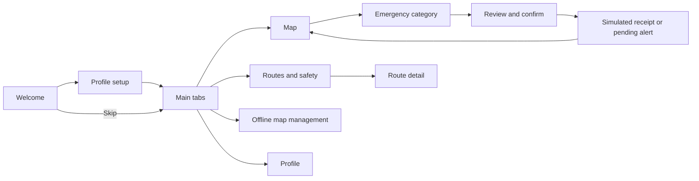

# Senda Segura

A mobile safety project for visitors to **Bosque La Primavera, Jalisco**, developed with **Fundación Más Bosque Manu**. The long-term system combines offline navigation, emergency communication through Bluetooth/LoRa beacons, and a ranger dashboard.

This repository implements the **mobile navigation and screen skeleton** for the assignment: **React Native + Expo SDK 58 + TypeScript + Expo Router**. It includes the project-specific flow from the supplied PDFs, with Spanish screens and working navigation.

**Current scope:** profile editing, map preparation, permission switches, and SOS outcomes are demonstrations held in memory. There is no persistence, backend, GPS access, real map download, Bluetooth, SMS, or ranger connection. Reloading resets the session. Every screen labels the app as a prototype.

## Run the project

Use a supported Node.js release (22.13+, 24.3+, or 26+) and npm; the exact supported ranges are in `package.json`. The initial dependency installation needs Internet access; the app requires no API keys or backend configuration.

```sh
npm ci
npm start
```

Open the QR code with an Expo SDK 58-compatible client, or use:

```sh
npm run android   # Android emulator/device tooling required
npm run ios       # macOS and an installed iOS simulator required
npm run web       # Browser preview
```

The repository is already initialized with Git. Keep `package-lock.json` committed. `.gitignore` excludes all `node_modules/` folders, Expo caches, generated native projects, build/test output, local environment files, and signing credentials.

## Implemented screens

| Route           | Screen and behavior                                                                                          |
| --------------- | ------------------------------------------------------------------------------------------------------------ |
| `/`             | Welcome/startup: begin profile setup or explore without a profile.                                           |
| `/setup`        | Profile setup: name/phone validation, simulated permission controls, and skip option.                        |
| `/map`          | Main map tab: illustrated forest map, demo status indicators, prominent SOS action, and pending demo alerts. |
| `/trails`       | Routes and safety tab: three illustrative routes and safety recommendations.                                 |
| `/trail/[id]`   | Route detail: example distance/duration/difficulty with a return path and map-preparation action.            |
| `/offline`      | Offline maps tab: simulate preparation, update check, and removal of a map package.                          |
| `/profile`      | Profile tab: edit the session profile, toggle example permissions, and navigate to safety/maps.              |
| `/sos`          | Select an emergency category; Continue stays disabled until selection.                                       |
| `/sos/confirm`  | Review profile/category, select a pending or received scenario, cancel, or explicitly simulate sending.      |
| `/sos/result`   | Display a simulated receipt or pending state; simulate recovery and return to the map.                       |
| Unmatched route | Recovery screen for unknown pages; invalid trail and missing-alert states also have recovery actions.        |

The map, routes, coordinates, accuracy, and package size are illustrative fixtures. The **SafeReport** login/upload example in the mobile PDF is not the Senda Segura flow and has not been imported into the app.

## Project structure

```text
Senda-Segura/
├── src/
│   ├── app/                    # Expo Router route files and layouts
│   │   ├── _layout.tsx         # Safe areas, session provider, root navigation
│   │   ├── index.tsx           # Welcome
│   │   ├── setup.tsx           # Onboarding
│   │   ├── +not-found.tsx      # Unknown-route recovery
│   │   ├── (tabs)/             # map, trails, offline, profile + layout
│   │   ├── trail/[id].tsx      # Route detail
│   │   └── sos/                # Category, confirmation, result + layout
│   ├── screens/                # Actual screen implementations
│   ├── navigation/             # RootNavigator, MainTabs, route constants
│   ├── components/             # Screen frame, buttons, form, SVG map/icons
│   ├── hooks/                  # DemoSessionProvider and useDemoSession
│   ├── data/                   # Illustrative routes, categories, map/location data
│   ├── constants/              # Colors, typography, shared styles
│   └── types/                  # Profile, alert, category, and trail types
├── docs/
│   ├── architecture.md         # Component/service diagrams and decisions
│   ├── project-context.md      # Preserved synthesis of all five project PDFs
│   └── testing.md              # Automated coverage and device review steps
├── tests/navigation.spec.ts    # Browser navigation/interaction tests
├── app.json                    # Expo configuration
├── package.json                # Scripts and dependencies
├── package-lock.json           # Reproducible npm dependency resolution
├── tsconfig.json               # Strict TypeScript and @/ source alias
├── eslint.config.js            # Expo ESLint configuration
├── playwright.config.ts        # Mobile browser test configuration
└── .gitignore
```

## Navigation and architecture

**Expo Router** is the navigation choice. Expo provides the React Native toolchain; React Native renders the screens. File-based routes make the logical navigation schema visible in the folder structure and provide browser URLs for review. Root/SOS stacks handle forward and back movement; four tabs expose frequently used destinations. The implementation follows the [Expo Router layout model](https://docs.expo.dev/router/basics/navigation-layouts/).



[Architecture and decisions](docs/architecture.md) explains the component boundaries, navigation graph, framework choice, memory-only state, explicit SOS confirmation, and planned backend services. The future system needs a map-content service, emergency API/database, beacon/station gateway, SMS ingestion, and authenticated ranger dashboard; these remain unconnected and their providers are not selected.

[Project context](docs/project-context.md) preserves the project description, source references, ownership/WBS, schedule, budget, success metrics, security requirements, and unresolved full-system decisions from all five PDFs.

## Validation

```sh
npm run typecheck
npm run lint
npx expo install --check
npm run export:web
npx playwright install chromium  # First browser test run only
npm run test:e2e
```

The browser tests cover setup validation, tab/detail navigation, profile and map state, SOS cancellation, simulated pending/received outcomes, and invalid links/reloads. See the [test guide](docs/testing.md) for manual Android/iOS checks. Web testing and bundle generation do not verify real device permissions, emergency communications, or field acceptance targets.

## Context for coding agents

- Work in this repository and inspect its current code before changing architecture. `src/app/` is reserved for route/layout files; reusable components belong outside it.
- Preserve the assignment boundary: no storage or backend is needed for this skeleton. Do not silently introduce credentials, authentication gates, device permissions, or real emergency transmission.
- Use `useDemoSession` for shared demo state and `data/demo.ts` for fixtures. Keep personal values out of URLs and use fictional values in tests.
- Keep simulated states explicit. A real station acknowledgment, backend receipt, and ranger response are different events; none is implemented by a demo success screen.
- Maintain Spanish UI copy, accessible labels, scrollable layouts, and usable cancellation/back paths. Avoid adding SafeReport's unrelated authentication/upload screens.
- Read the architecture decisions and source context before implementing full-system features. Update documentation when a previously proposed contract or service becomes real.
- Run type checking, lint, and relevant navigation checks after changes. Report native/hardware/field checks separately from browser results.
