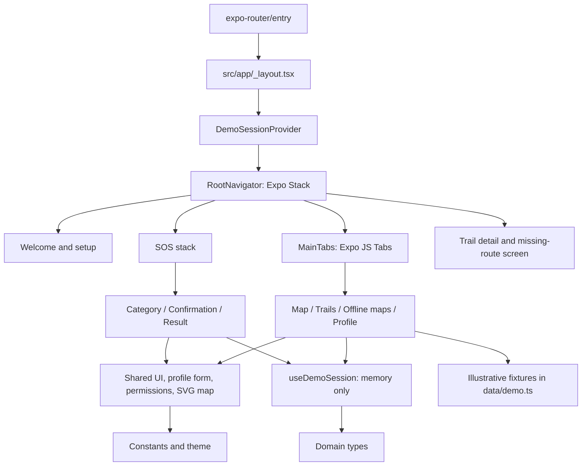
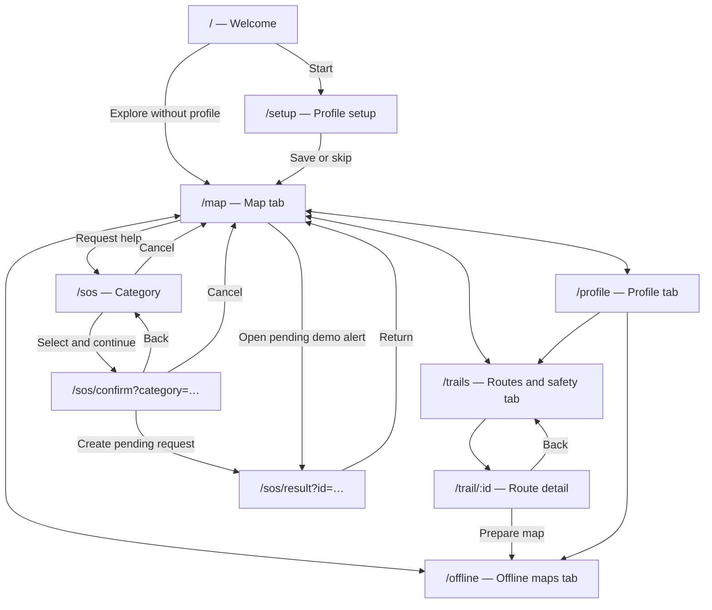
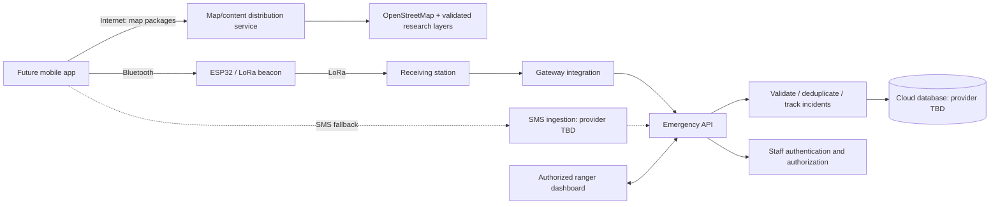

# Architecture and decisions

[README](../README.md) · [Source-based project context](project-context.md)

## Current implementation

The interface uses regular product wording without prototype/demo banners. All services remain disconnected. Creating an SOS request records it in memory with a pending status; retry reports that the sending service is unavailable and never produces a receipt. Technical limitations are documented here rather than shown as demo labels throughout the app.

This assignment implements the mobile navigation and screen skeleton. All profile, permission, map-download, and alert state is held in React memory. No storage SDK, HTTP client, authentication provider, GPS, Bluetooth, SMS, map provider, or backend is connected.

The files under `src/app/` declare URL routes and layouts. They import screen implementations from `src/screens/`, keeping component/helper files outside the router's directory. Layouts register the navigation components under `src/navigation/`. The root provider survives route changes, but a full reload creates a new session.

## Implemented screens

| Route           | Screen and behavior                                                                                     |
| --------------- | ------------------------------------------------------------------------------------------------------- |
| `/`             | Welcome/startup: begin profile setup or explore without a profile.                                      |
| `/setup`        | Profile setup: name/phone validation, simulated permission controls, and skip option.                   |
| `/map`          | Main map tab: illustrated forest map, status indicators, prominent SOS action, and pending demo alerts. |
| `/trails`       | Routes and safety tab: three illustrative routes and safety recommendations.                            |
| `/trail/[id]`   | Route detail: example distance/duration/difficulty with a return path and map-preparation action.       |
| `/offline`      | Offline maps tab: simulate preparation, update check, and removal of a map package.                     |
| `/profile`      | Profile tab: edit the session profile, toggle example permissions, and navigate to safety/maps.         |
| `/sos`          | Select an emergency category; Continue stays disabled until selection.                                  |
| `/sos/confirm`  | Review profile/category, cancel, or create a pending request.                                           |
| `/sos/result`   | Display a pending request; retry without sending and return to the map.                                 |
| Unmatched route | Recovery screen for unknown pages; invalid trail and missing-alert states also have recovery actions.   |

The map, routes, coordinates, accuracy, and package size are illustrative fixtures. The **SafeReport** login/upload example in the mobile PDF is not the Senda Segura flow and has not been imported into the app.

## Navigation graph

Tabs are reserved for frequent destinations. SOS screens live above the tabs so the user can focus on the flow. Back returns to the previous screen; cancellation dismisses the SOS flow to the map. Confirmation is replaced by the result to avoid returning directly to a submitted form. A synchronous guard also prevents duplicate records from rapid presses.

Only category IDs, trail IDs, and opaque demo alert IDs appear in route parameters. Names, phone numbers, and other profile values stay in memory. Unknown categories redirect to category selection. Missing alerts after a reload and unknown trails have recovery screens.

## Architecture decisions

| ID      | Decision                                                                                        | Reason and consequence                                                                                                                                                                                                                                                                  |
| ------- | ----------------------------------------------------------------------------------------------- | --------------------------------------------------------------------------------------------------------------------------------------------------------------------------------------------------------------------------------------------------------------------------------------- |
| ADR-001 | React Native + Expo SDK 58, TypeScript, and **Expo Router**.                                    | Matches the current class example and gives one app for Android/iOS plus a browser preview. Expo is the toolchain; React Native is the UI platform; Expo Router is the navigation choice. It is not a choice between Expo and React Native as competing navigation libraries.           |
| ADR-002 | File-based routes, a root stack, and four JavaScript tabs.                                      | Files map directly to the logical navigation schema. Stacks support forward/back SOS steps; tabs expose the map, safety content, downloads, and profile. Use Expo Router APIs consistently rather than adding a second navigation container.                                            |
| ADR-003 | Thin route files and separate screens/components/data/hooks/constants/navigation/types folders. | Route discovery cannot mistake helpers for screens. Shared UI stays reusable, fixtures stay replaceable, and navigation policy has a clear home.                                                                                                                                        |
| ADR-004 | One small React context for temporary demo state.                                               | The assignment explicitly permits omitting storage and backends. A context is sufficient for cross-screen edits without introducing a state library or accidentally promising persistence. Restarting loses the profile and all alerts.                                                 |
| ADR-005 | An illustrated SVG map and disconnected transport/permission controls.                          | Demonstrates the conceptual screens without map keys, downloads, radio hardware, or OS permission prompts. The interface uses product copy; fixtures and temporary state remain documented as simulated. Alert status never claims rescue receipt.                                      |
| ADR-006 | Explicit confirmation button in this skeleton.                                                  | The PDFs propose a five-second countdown pending rescue-team validation. This implementation uses a deliberate “Solicitar ayuda” action so reviewers can inspect confirmation and cancel deterministically. A real countdown is deferred with its cancellation/acknowledgment protocol. |
| ADR-007 | No login gate; profile setup is skippable.                                                      | The project mockups favor local startup and emergency access. SafeReport's login/registration example is not the Senda Segura contract. Future identity design must preserve the offline requirements.                                                                                  |
| ADR-008 | Senda Segura branding and Spanish UI.                                                           | Uses the charter/repository name while retaining the language and forest-green/cream/red visual vocabulary of the supplied mockups. “La Primavera SOS” remains a source working title.                                                                                                  |
| ADR-009 | Commit the npm lockfile; ignore dependencies, generated native folders, and build output.       | Makes installs reproducible. Expo generates native projects when needed. If custom native code is later maintained directly, revisit the `/android/` and `/ios/` ignore rules.                                                                                                          |

Routing setup follows [Expo's installation guidance](https://docs.expo.dev/router/installation/), [layout model](https://docs.expo.dev/router/basics/navigation-layouts/), and [navigation APIs](https://docs.expo.dev/router/basics/navigation/). Package versions follow the SDK 58 compatibility map and the local class project; `package-lock.json` records the installed resolution.

## Planned services — not connected

The PDFs specify service responsibilities but do not select backend vendors or a final database. This assignment preserves those boundaries without presenting a provider choice as approved. No environment variables, API keys, or external accounts are needed to run the skeleton.

| Planned boundary             | Responsibility                                                                                             | Before implementation                                                                                                    |
| ---------------------------- | ---------------------------------------------------------------------------------------------------------- | ------------------------------------------------------------------------------------------------------------------------ |
| Map/content distribution     | Versioned downloadable maps and validated route/safety overlays.                                           | Select a map SDK, source/distribution arrangement, package format, and update policy. The source endpoint is a proposal. |
| Emergency API and processing | Validate input and identity, deduplicate alert IDs, persist incidents, and manage status changes.          | Agree on schemas, acknowledgment semantics, access controls, retention, and hosting/database selection.                  |
| Beacon/station gateway       | Accept Bluetooth alerts, relay LoRa packets, and forward station receipts to backend services.             | Define packet size, authenticity/replay protection, retry and acknowledgment contracts; test physical hardware.          |
| SMS ingestion                | Provide a fallback when cellular service is available.                                                     | Select recipient/provider and delivery evidence; accommodate iOS user-confirmed sending.                                 |
| Ranger access/dashboard      | Authenticated incident viewing, notifications, and audited `recibida → en atención → cerrada` transitions. | Define staff roles, session management, dashboard transport, and the operational response protocol.                      |

A station receipt, a saved backend record, and a ranger taking action are separate events. The current app only creates pending requests; it cannot produce a confirmed outcome without a connected service. The memory-only pending list is likewise not the persistent retry queue required by the full project.

## Extension points

- Replace illustrative map rendering only after selecting the offline map SDK; keep GPS availability and package availability separate.
- Introduce storage and transport adapters behind the session/domain boundaries when their contracts are approved. Do not convert demo success to a real receipt without verified acknowledgment.
- Add actual permission requests and device checks per platform; the current switches never touch native permissions.
- Implement backend and ranger UI as separate deliverables; no server-side code is hidden in the mobile routes.
- Apply the source security checklist and physical-device/field acceptance metrics when real services are introduced.
