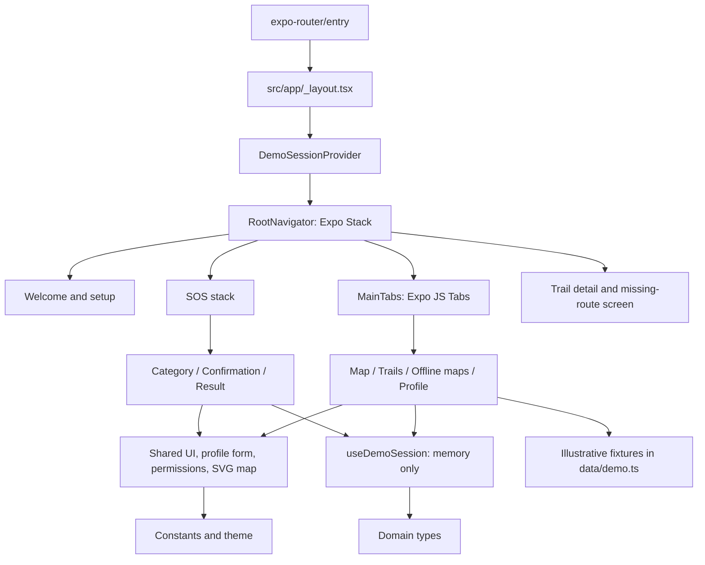
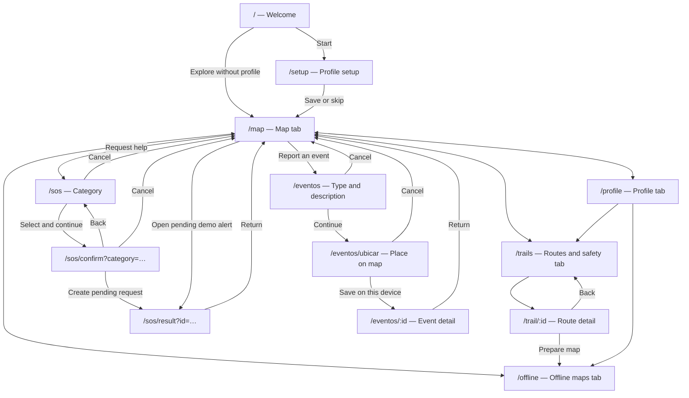
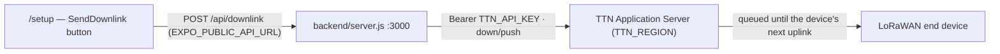
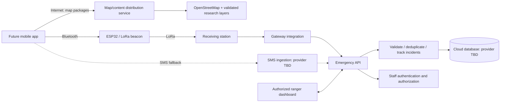

# Architecture and decisions

[README](../README.md) · [Source-based project context](project-context.md)

## Current implementation

The interface uses regular product wording without prototype/demo banners. All services remain disconnected. Creating an SOS request records it in memory with a pending status; retry reports that the sending service is unavailable and never produces a receipt. Technical limitations are documented here rather than shown as demo labels throughout the app.

This assignment implements the mobile navigation and screen skeleton. All profile, permission, map-download, alert, and trail-event state is held in React memory. No storage SDK, authentication provider, GPS, Bluetooth, SMS, or map provider is connected. The only network integration is an experimental LoRaWAN downlink proxy in `backend/`; see [LoRaWAN downlink proxy](#lorawan-downlink-proxy). It is not part of the SOS flow and does not transmit emergency alerts.

Trail events saved during the session stay on this device and are not transmitted. The offline tab no longer includes an example map package, version, or update check. Download and updates of that package are left for the backend.

The files under `src/app/` declare URL routes and layouts. They import screen implementations from `src/screens/`, keeping component/helper files outside the router's directory. Layouts register the navigation components under `src/navigation/`. The root provider survives route changes, but a full reload creates a new session.

## Implemented screens

| Route             | Screen and behavior                                                                                           |
| ----------------- | ------------------------------------------------------------------------------------------------------------- |
| `/`               | Welcome/startup: begin profile setup or explore without a profile.                                            |
| `/setup`          | Profile setup: name/phone validation, simulated permission controls, and skip option.                         |
| `/map`            | Main map tab: illustrated forest map, status indicators, prominent SOS action, and pending demo alerts.       |
| `/trails`         | Routes and safety tab: three illustrative routes and safety recommendations.                                  |
| `/trail/[id]`     | Route detail: example distance/duration/difficulty with a return path and map-preparation action.             |
| `/offline`        | Offline maps tab: describes the package. Download and update are not available in the app.                    |
| `/profile`        | Profile tab: edit the session profile, toggle example permissions, and navigate to safety/maps.               |
| `/sos`            | Select an emergency category; Continue stays disabled until selection.                                        |
| `/sos/confirm`    | Review profile/category, cancel, or create a pending request.                                                 |
| `/sos/result`     | Display a pending request; retry without sending and return to the map.                                       |
| `/eventos`        | Choose a trail-event type. A name and description are required only for “Otro”.                               |
| `/eventos/ubicar` | Place the event by tapping the map or using the current location, then save it on this device.                |
| `/eventos/[id]`   | Event detail for a report saved on this device. An unknown id returns to the map.                             |
| Unmatched route   | Recovery screen for unknown pages; invalid trail, event, and missing-alert states also have recovery actions. |

The map, routes, coordinates, accuracy, and package size are illustrative fixtures. The **SafeReport** login/upload example in the mobile PDF is not the Senda Segura flow and has not been imported into the app.

## Navigation graph

Tabs are reserved for frequent destinations. SOS and trail-event screens live above the tabs so the user can focus on each flow. Back returns to the previous screen; cancellation dismisses the flow to the map. Confirmation is replaced by the result to avoid returning directly to a submitted form. A synchronous guard also prevents duplicate records from rapid presses.

Only category IDs, trail IDs, and opaque alert or event IDs appear in route parameters. Names, phone numbers, event descriptions, and other profile values stay in memory. Unknown categories redirect to category selection. A trail-event draft is required before placement. Missing alerts after a reload, unknown trails, and unknown events have recovery screens.

## Architecture decisions

| ID      | Decision                                                                                        | Reason and consequence                                                                                                                                                                                                                                                                  |
| ------- | ----------------------------------------------------------------------------------------------- | --------------------------------------------------------------------------------------------------------------------------------------------------------------------------------------------------------------------------------------------------------------------------------------- |
| ADR-001 | React Native + Expo SDK 58, TypeScript, and **Expo Router**.                                    | Matches the current class example and gives one app for Android/iOS plus a browser preview. Expo is the toolchain; React Native is the UI platform; Expo Router is the navigation choice. It is not a choice between Expo and React Native as competing navigation libraries.           |
| ADR-002 | File-based routes, a root stack, and four JavaScript tabs.                                      | Files map directly to the logical navigation schema. Stacks support forward/back SOS steps; tabs expose the map, safety content, downloads, and profile. Use Expo Router APIs consistently rather than adding a second navigation container.                                            |
| ADR-003 | Thin route files and separate screens/components/data/hooks/constants/navigation/types folders. | Route discovery cannot mistake helpers for screens. Shared UI stays reusable, fixtures stay replaceable, and navigation policy has a clear home.                                                                                                                                        |
| ADR-004 | One small React context for temporary demo state.                                               | The assignment explicitly permits omitting storage and backends. A context is sufficient for cross-screen edits without introducing a state library or accidentally promising persistence. Restarting loses the profile, alerts, and local trail events.                                |
| ADR-005 | An illustrated SVG map and disconnected transport/permission controls.                          | Demonstrates the conceptual screens without map keys, downloads, radio hardware, or OS permission prompts. The interface uses product copy; fixtures and temporary state remain documented as simulated. Alert status never claims rescue receipt.                                      |
| ADR-006 | Explicit confirmation button in this skeleton.                                                  | The PDFs propose a five-second countdown pending rescue-team validation. This implementation uses a deliberate “Solicitar ayuda” action so reviewers can inspect confirmation and cancel deterministically. A real countdown is deferred with its cancellation/acknowledgment protocol. |
| ADR-007 | No login gate; profile setup is skippable.                                                      | The project mockups favor local startup and emergency access. SafeReport's login/registration example is not the Senda Segura contract. Future identity design must preserve the offline requirements.                                                                                  |
| ADR-008 | Senda Segura branding and Spanish UI.                                                           | Uses the charter/repository name while retaining the language and forest-green/cream/red visual vocabulary of the supplied mockups. “La Primavera SOS” remains a source working title.                                                                                                  |
| ADR-009 | Commit the npm lockfile; ignore dependencies, generated native folders, and build output.       | Makes installs reproducible. Expo generates native projects when needed. If custom native code is later maintained directly, revisit the `/android/` and `/ios/` ignore rules.                                                                                                          |
| ADR-010 | A separate Node/Express process in `backend/` proxies LoRaWAN downlinks to The Things Network.  | Keeps the TTN API key off the phone. The app calls a fixed, allowlisted command endpoint and never builds raw payloads itself. The proxy is a hardware-test tool, not the planned emergency API, and it must not be presented as alert delivery.                                        |

Routing setup follows [Expo's installation guidance](https://docs.expo.dev/router/installation/), [layout model](https://docs.expo.dev/router/basics/navigation-layouts/), and [navigation APIs](https://docs.expo.dev/router/basics/navigation/). Package versions follow the SDK 58 compatibility map and the local class project; `package-lock.json` records the installed resolution.

## LoRaWAN downlink proxy

`backend/server.js` is a single-route Express 5 server. It queues configuration commands for a LoRaWAN end device registered in a The Things Network (TTN) application. It was added to test the beacon hardware path and is the first real network service in the repository.

### Contract

`POST /api/downlink` with a JSON body:

| Field       | Type                          | Notes                                                                        |
| ----------- | ----------------------------- | ---------------------------------------------------------------------------- |
| `devId`     | string                        | TTN end-device ID inside `TTN_APP_ID`. The app currently sends `prueba-abp`. |
| `command`   | `"reboot"` \| `"setInterval"` | Allowlisted command name.                                                    |
| `value`     | number                        | Seconds for `setInterval`, 0–65535. Ignored by `reboot`.                     |
| `confirmed` | boolean                       | Optional, default `true`. Requests a confirmed downlink from TTN.            |

| Command       | Payload (hex)                             | Example              |
| ------------- | ----------------------------------------- | -------------------- |
| `reboot`      | `FF 10 FF`                                | —                    |
| `setInterval` | `FF 03` + seconds as uint16 little-endian | 60 s → `FF 03 3C 00` |

Payloads are sent on FPort 85 with `NORMAL` priority. Responses:

| Status | Body                                         | Meaning                                                                        |
| ------ | -------------------------------------------- | ------------------------------------------------------------------------------ |
| 202    | `{ queued: true, hex, ttnStatus, ttnBody }`  | TTN accepted the downlink into the device queue.                               |
| 502    | `{ queued: false, hex, ttnStatus, ttnBody }` | TTN rejected the request (for example, a wrong key, app, or device ID).        |
| 400    | `{ error: "Comando no permitido" }`          | The command is not allowlisted.                                                |
| 500    | Express default HTML error page              | Unhandled error; see the known issues in [testing](testing.md#backend-checks). |

**202 means "queued in TTN", not "delivered".** A Class A device receives the downlink only after its next uplink. The proxy does not subscribe to TTN events, so it cannot report delivery, the confirmed-downlink acknowledgment, or whether the device applied the command. The app's message ("Se entregará en el próximo uplink del sensor") must stay worded as pending.

### Configuration

| Variable              | Where          | Purpose                                                                                                    |
| --------------------- | -------------- | ---------------------------------------------------------------------------------------------------------- |
| `TTN_REGION`          | `backend/.env` | TTN cluster, default `nam1`.                                                                               |
| `TTN_APP_ID`          | `backend/.env` | TTN application ID.                                                                                        |
| `TTN_API_KEY`         | `backend/.env` | TTN API key with downlink-write rights for that application. It must stay on the server.                   |
| `EXPO_PUBLIC_API_URL` | root `.env`    | Base URL of the proxy, as reached from the phone. On a device, use the computer's LAN IP, not `localhost`. |

`backend/.env.example` lists the server variables. Both `.env` files are gitignored. `EXPO_PUBLIC_*` values are compiled into the app bundle, so this variable must never hold a secret. The listening port is fixed at 3000.

### App integration

- `src/services/downlinkApi.ts` posts to the proxy and throws when the response is not OK.
- `src/components/SendDownlink.tsx` renders an "Enviar comando" button that queues `setInterval` = 60 s and displays the status.
- `src/screens/SetupScreen.tsx` renders `<SendDownlink devId="prueba-abp" />`. The code marks it as temporary, so it should be removed or moved behind a developer-only screen before review builds.

### Limitations

- No authentication, authorization, or rate limiting. Anyone who can reach port 3000 can reboot or reconfigure devices using the server's TTN key. Run it only on a trusted network.
- No CORS headers, so the Expo web preview cannot call it from another origin. Native clients are unaffected.
- `devId` and `value` are not validated, and the command lookup accepts inherited object keys. The recorded test results describe the consequences.
- No delivery tracking, persistence, or logging beyond the console.

## Planned services — not connected

The PDFs specify service responsibilities but do not select backend vendors or a final database. This assignment preserves those boundaries without presenting a provider choice as approved. The navigation skeleton needs no environment variables, API keys, or external accounts. Only the optional downlink proxy above needs TTN credentials.

| Planned boundary             | Responsibility                                                                                             | Before implementation                                                                                                    |
| ---------------------------- | ---------------------------------------------------------------------------------------------------------- | ------------------------------------------------------------------------------------------------------------------------ |
| Map/content distribution     | Versioned downloadable maps and validated route/safety overlays.                                           | Select a map SDK, source/distribution arrangement, package format, and update policy. The source endpoint is a proposal. |
| Emergency API and processing | Validate input and identity, deduplicate alert IDs, persist incidents, and manage status changes.          | Agree on schemas, acknowledgment semantics, access controls, retention, and hosting/database selection.                  |
| Beacon/station gateway       | Accept Bluetooth alerts, relay LoRa packets, and forward station receipts to backend services.             | Define packet size, authenticity/replay protection, retry and acknowledgment contracts; test physical hardware.          |
| SMS ingestion                | Provide a fallback when cellular service is available.                                                     | Select recipient/provider and delivery evidence; accommodate iOS user-confirmed sending.                                 |
| Ranger access/dashboard      | Authenticated incident viewing, notifications, and audited `recibida → en atención → cerrada` transitions. | Define staff roles, session management, dashboard transport, and the operational response protocol.                      |

A station receipt, a saved backend record, and a ranger taking action are separate events. The current app only creates pending requests; it cannot produce a confirmed outcome without a connected service. The memory-only pending list is likewise not the persistent retry queue required by the full project.

## Extension points

- Replace illustrative map rendering only after selecting the offline map SDK; keep GPS availability and package availability separate.
- Introduce storage and transport adapters behind the session/domain boundaries when their contracts are approved. Do not convert demo success to a real receipt without verified acknowledgment.
- Add actual permission requests and device checks per platform; the current switches never touch native permissions.
- Implement backend and ranger UI as separate deliverables; no server-side code is hidden in the mobile routes. Server code lives in `backend/` with its own `package.json`. The downlink proxy may grow into the station/gateway integration, but it must first gain authentication, input validation, and delivery tracking.
- Apply the source security checklist and physical-device/field acceptance metrics when real services are introduced.
