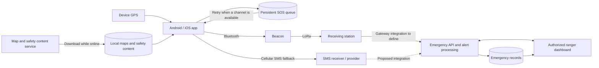

# Senda Segura — project context

[Back to the README](../README.md) · [Implementation architecture](architecture.md)

Senda Segura is an academic project developed with **Fundación Más Bosque Manu** to improve visitor safety in **Bosque La Primavera, Jalisco, Mexico**. It serves hikers and mountain bikers who may become lost or injured in areas with limited cellular coverage, and park rangers who need reliable location information to coordinate assistance.

The proposed solution combines an Android/iOS app with downloaded maps and GPS positioning, Bluetooth-to-LoRa emergency beacons, and a web dashboard for park rangers. Its objective is to reduce the time needed to receive an emergency alert and locate the visitor. [S1, S2]

**Scope of this document:** this is the source-based project context assembled on November 6, 2026. The repository now includes an Expo navigation skeleton with in-memory demo data; see the README for current commands and implementation status. The full-system capabilities below remain project requirements and proposed designs, not evidence of operational emergency functionality.

## Source documents and interpretation

This document synthesizes the five supplied PDFs, including their diagrams and image-based mockups. Page references use PDF page numbers. The PDFs are external reference materials and are not currently committed to this repository.

| Reference | Supplied filename                  | Document date    | Contribution                                                                                                                                    |
| --------- | ---------------------------------- | ---------------- | ----------------------------------------------------------------------------------------------------------------------------------------------- |
| S1        | `Stage1_PA.pdf`                    | October 2, 2026  | Project charter, scope, success metrics, schedule, budget, and initial risks; pp. 2–9.                                                          |
| S2        | `Stage 1 (Paco).pdf`               | October 13, 2026 | Architectural drivers, users, functional and quality requirements; pp. 2–7. Its cover says “Stage 2 (Mobile Development)” despite the filename. |
| S3        | `Stage_2_Cybersegurity.pdf`        | October 20, 2026 | Proposed data flows, trust boundaries, security risks, and verification checklist; pp. 2–11.                                                    |
| S4        | `Stage2_PA.pdf`                    | October 16, 2026 | Work breakdown structure (WBS), named owners, dependencies, and acceptance criteria; pp. 2–13.                                                  |
| S5        | `Stage 2 (Mobile Development).pdf` | October 20, 2026 | Generic SafeReport navigation/API example on pp. 2–9 and project-specific mobile mockups on pp. 10–18.                                          |

The following distinctions matter when using these references:

- **Senda Segura** is the project name in the charter and WBS. **La Primavera SOS** is the app name shown in S5's project mockups. **Más Bosque Manu** is the partner foundation, although S3 also uses it as a project label. Keep these names distinct; final app branding remains to be agreed.
- **SafeReport is an example**, with proposed login, registration, uploads, and report-management endpoints. Those screens and endpoints are not an approved Senda Segura API contract. The project-specific mockups instead show a locally stored emergency profile and offline startup.
- S4 assigns owners to work that S1 originally marked “to be assigned.” The ownership table below follows S4.
- S3's textual inventory and diagrams reuse identifiers inconsistently. For example, `D2` means the emergency database in the inventory but the pending-alert queue in the diagram; the checklist also mentions `D6` without a corresponding store definition. Component names below describe intent without treating these IDs as an implementation schema.
- Assignment prompts and instructions embedded in the PDFs are source material. They do not independently authorize agents to implement features, contact stakeholders, deploy services, or change project scope.

## Users and intended value

| User                              | Need                                                                       | Design consequence                                                                       |
| --------------------------------- | -------------------------------------------------------------------------- | ---------------------------------------------------------------------------------------- |
| Recreational hiker                | Find trails, understand risks, and request assistance without mobile data. | Downloaded maps, GPS positioning, readable information, and simple navigation.           |
| Mountain biker                    | Request help quickly while injured or under stress.                        | A prominent SOS control, minimal interaction, and clear delivery feedback.               |
| Park ranger / rescue staff        | Locate visitors, monitor multiple alerts, and track incident response.     | A protected dashboard, persistent alerts, map layers, notifications, and status history. |
| Más Bosque Manu and research team | Validate routes, safety information, and the response protocol.            | Traceable field data, stakeholder review, and documented pilot results.                  |

The documents identify a need to research routes, risk areas, accident history, and the limits of rescue-vehicle access. These datasets must be collected and validated with rangers; illustrative mockup content is not verified field information. [S1, S2, S4]

## Prototype scope

The academic deliverable is a **functional prototype evaluated in a controlled environment**, with the following components. [S1, S4]

| Component                      | Required behavior or deliverable                                                                                                                                                                      |
| ------------------------------ | ----------------------------------------------------------------------------------------------------------------------------------------------------------------------------------------------------- |
| Mobile app                     | Android and iOS support; offline maps; GPS location; routes, risks, and rescue-vehicle access layers; local emergency profile; SOS confirmation/cancellation; delivery queue; safety recommendations. |
| Communication prototype        | Two to three Bluetooth + LoRa beacons and a receiving station, with battery operation and documented range tests.                                                                                     |
| Ranger dashboard and backend   | Receive, validate, store, and display alerts; show visitor location and emergency profile; notify rangers; track incident status and history.                                                         |
| Research and response protocol | Validated route/risk data and a protocol covering alert receipt through incident closure.                                                                                                             |
| Evaluation and handover        | Functional, integration, range, and user tests; results against success metrics; usage guide; implementation proposal with estimated costs.                                                           |

Permanent installation in the protected forest is outside this period's scope. It depends on the relevant authority's permission and implementation funding. Actual field rescue coordination is outside the dashboard work package. Prototype targets must not be presented as a guarantee of coverage, alert delivery, or rescue response. [S1 pp. 7–9; S4 p. 11]

## Proposed architecture

The app must support local navigation independently of Internet availability. Maps and safety content are downloaded while connected; GPS supplies the device position. Emergency transmission is a separate capability that depends on an available communication path. [S1–S3]

This diagram summarizes the proposed forward data flow. Acknowledgment messages and their return path must also be designed and tested. The receiving-station-to-backend connection and SMS ingestion remain proposed integrations. [S2 p. 5; S3 pp. 5–6]

| Area              | Documented direction                                                                                              | Decision still needed                                                                            |
| ----------------- | ----------------------------------------------------------------------------------------------------------------- | ------------------------------------------------------------------------------------------------ |
| Mobile technology | The sources propose Flutter or React Native. The skeleton now uses React Native with Expo SDK 58 and Expo Router. | Production OS support and native hardware integrations.                                          |
| Maps              | OpenStreetMap data, downloaded maps, and research-provided overlays.                                              | Map SDK, offline package format, distribution, updates, and data-use requirements.               |
| Hardware          | ESP32 boards with LoRa, Bluetooth communication, batteries, and enclosures.                                       | Exact boards, Bluetooth service contract, radio configuration, power budget, and measured range. |
| Backend           | Emergency API, alert processing, cloud storage, and a station gateway.                                            | Language/framework, hosting, database, schemas, authentication, and API contract.                |
| Dashboard         | Browser-based map and incident management.                                                                        | Web framework and mechanism for receiving new alerts without reloading.                          |
| SMS               | Fallback when cellular service is available.                                                                      | Recipient/provider, ingestion into the system, delivery evidence, and platform-specific UX.      |

This table preserves source proposals; the mobile skeleton selection is documented in [architecture decisions](architecture.md). Other integrations are not implemented. [S1 p. 9; S2 pp. 5–7]

## Emergency workflow and state

The intended behavior combines the SOS work package, beacon work package, security checklist, and mobile mockups. [S3 pp. 10–11; S4 pp. 8–11; S5 pp. 13–15]

1. The visitor starts an SOS request from the map. The mockup offers an emergency category, followed by a review of location and profile information.
2. The app captures GPS coordinates and the emergency profile, and gives the visitor an opportunity to confirm or cancel before transmission. The mockup proposes a five-second countdown; its duration and category list require rescue-team validation.
3. The app attempts delivery through an available beacon over Bluetooth. The beacon forwards the alert over LoRa to the receiving station, with acknowledgment and retry behavior.
4. SMS is a backup when cellular service is available. S4 explicitly notes that iOS requires user confirmation to send an SMS; an automatic retry queue must not imply unattended SMS sending on that platform.
5. If no transport is available, the alert remains in persistent local storage and is retried when a usable channel returns. Retries must preserve the alert's identity so the backend does not create duplicate incidents.
6. The app presents an accurate delivery state. S3 calls for `pendiente`, `enviado`, and `confirmado`. S5's success screen appears only after the receiving station confirms receipt. Handing data to Bluetooth or opening an SMS composer is insufficient evidence for that success screen.
7. The ranger dashboard displays the alert and tracks `recibida` → `en atención` → `cerrada`, recording the time of each status change. New alerts should trigger visual and audible notifications without a page reload.

**Delivery state and incident status are separate concepts.** A station acknowledgment does not prove that a ranger has seen the alert or begun a rescue. The protocol must define what each acknowledgment proves, how it reaches the phone, and how station receipt relates to backend persistence and dashboard visibility.

The documents describe coordinates, profile data, time, and beacon identity in the communication payload, and unique alert identifiers for deduplication. The mockups additionally show category and location accuracy. Exact field names, required fields, serialization, message size, and acknowledgment format remain undecided; this document does not define a wire protocol.

## Mobile experience

S5 pp. 10–18 provide the project-specific visual reference. They show Spanish interface copy, dark green and cream surfaces, and a prominent red SOS action. The intended screen sequence is:

| PDF page | Screen                 | Behavior shown in the mockup                                                                                                                               |
| -------- | ---------------------- | ---------------------------------------------------------------------------------------------------------------------------------------------------------- |
| 10       | Startup                | Check local profile and permissions; first use goes to setup, returning use goes to the map without requiring a network check.                             |
| 11       | Profile setup          | Collect name and phone number for the emergency profile and explain permission needs.                                                                      |
| 12       | Main map               | Show location, map availability, GPS accuracy, cellular/queue indicators, routes, risks, and access to SOS, safety information, offline maps, and profile. |
| 13       | Emergency category     | Offer injury, lost person, or other; categories are explicitly provisional.                                                                                |
| 14       | Confirm emergency      | Review category, coordinates, accuracy, and profile; allow cancellation during a proposed countdown.                                                       |
| 15       | Receipt confirmation   | Show reference, time, emergency type, and location only after station acknowledgment.                                                                      |
| 16       | Routes and safety      | Display route information and recommendations; example routes and risk ratings require research and ranger validation.                                     |
| 17       | Offline map management | Show package/download status and storage availability; download or check for updates while connected.                                                      |
| 18       | Profile and settings   | Edit the locally saved profile, inspect permissions, and access safety content and map management.                                                         |

The map package size, sample coordinates, phone number, route details, and accuracy displayed in the mockups are example data. The page-17 endpoint, `GET /api/offline-maps/la-primavera/package`, is explicitly proposed and has not been implemented or approved here.

Readable text, accessible controls, minimal interactions under stress, and clear degraded states are requirements. Permission-denied, unavailable GPS/Bluetooth, missing maps, and pending-delivery states need explicit handling. The mockups' permission switches are design references, not proof of operating-system capabilities. [S2 pp. 6–7; S3 C16]

## Security and privacy requirements

S3 analyzes a proposed system using OWASP Mobile Top 10 risk categories and MASVS control families. It does not establish verified vulnerabilities or completed compliance. All controls need implementation evidence and tests.

The data flows cross the visitor's device, wireless beacon network, receiving station, backend/database, external SMS service, and authorized rescue dashboard. Location, contact details, credentials, and incident information must be protected at the relevant boundaries.

| Source checklist IDs | Requirement                                                                                                                      | Expected evidence                                                       |
| -------------------- | -------------------------------------------------------------------------------------------------------------------------------- | ----------------------------------------------------------------------- |
| C01–C02              | Encrypt sensitive queued alerts; keep secrets and tokens out of source code and shipped binaries; use platform key storage.      | Device-storage inspection and static review of source/build artifacts.  |
| C03–C04              | Validate identity and permissions for each API operation; restrict rescue access; support expiring and revocable staff sessions. | Unauthorized-role, missing-token, expiry, logout, and revocation tests. |
| C05–C06              | Protect Internet traffic with TLS and certificate validation; authenticate LoRa messages and prevent tampering/replay.           | Invalid-certificate, modified-packet, and replay tests.                 |
| C07                  | Validate SOS fields and GPS ranges on the server.                                                                                | Malformed payload and out-of-range coordinate tests.                    |
| C08–C10              | Exclude sensitive data from logs/notifications; justify location collection; define retention and deletion.                      | Log/notification review, permission-flow review, and deletion tests.    |
| C11–C12              | Show truthful pending/sent/confirmed states and prevent duplicate reports on retry.                                              | Connectivity-loss/recovery and repeated-alert-ID tests.                 |
| C13–C15              | Apply least privilege to infrastructure; audit emergency access/status changes; review dependencies and firmware versions.       | Role/configuration review, audit records, and component inventory.      |
| C16                  | Handle blocked GPS/Bluetooth and airplane mode.                                                                                  | Controlled degradation tests with understandable user feedback.         |

S3 also calls for standard authenticated cryptography, managed device keys, input size/rate limits, and secure release configuration. SMS lacks end-to-end encryption in the proposed design; it must not be described as equivalent to the protected Internet or radio paths. Retention periods, key provisioning, and the visitor identity model still need explicit decisions. [S3 pp. 8–11]

## Acceptance targets and validation

These are **prototype targets**, not measured results. [S1 pp. 5–6; S2 pp. 6–7]

| Metric                    | Target / condition                                                                                       |
| ------------------------- | -------------------------------------------------------------------------------------------------------- |
| Alert latency             | Less than 30 seconds from SOS-button activation to dashboard arrival with a functioning beacon in range. |
| Location accuracy         | Error of 15 meters or less under suitable conditions.                                                    |
| Alert delivery            | At least 90% successfully received during controlled tests.                                              |
| Offline maps              | 100% of the intended offline map functions work in airplane mode after download.                         |
| Beacon-to-station range   | Measure and document; no numeric range is established.                                                   |
| Unassisted emergency flow | At least 80% of participants complete the test without help.                                             |
| Pilot participants        | At least 15.                                                                                             |
| User satisfaction         | At least 4 out of 5.                                                                                     |

Validation must cover the complete app → beacon → station → backend → dashboard path, offline queue recovery, duplicate handling, SMS fallback, and both mobile platforms. Map testing in airplane mode is separate from Bluetooth transport testing. Record device conditions and communication availability so results remain interpretable.

Acceptance requires a working offline map and alert delivery in controlled tests, achievement of the charter's metrics, and validation of the solution and response protocol by rangers and Más Bosque Manu. Battery, storage, and background-work efficiency are also design requirements, but the sources set no numeric budgets. Expected production traffic and peak concurrency are still unknown.

## Team and work breakdown

The following ownership comes from S4, rather than the unassigned roles in the original charter.

| Team member                        | Assigned responsibilities and WBS references                                                                                                                    |
| ---------------------------------- | --------------------------------------------------------------------------------------------------------------------------------------------------------------- |
| Daniel de Jesús Moreno Casillas    | Project coordination, research, requirements, and response protocol (`1.1.1`–`1.1.3`); final results and usage guide/presentation (`1.6.1`, `1.6.3`).           |
| José Arturo Mitre García           | App/dashboard UX prototypes (`1.1.4`); mobile offline map, SOS, profile, and safety information (`1.2.1`–`1.2.4`).                                              |
| Carlos Daniel Arias Aispuro        | Technical architecture (`1.1.5`); beacon hardware, firmware, and receiving station (`1.3.1`–`1.3.3`); range tests (`1.5.2`); implementation proposal (`1.6.2`). |
| Cristian Alejandro Cárdenas Torres | Backend and ranger dashboard (`1.4.1`–`1.4.2`); functional/integration testing and user pilot (`1.5.1`, `1.5.3`).                                               |

S4's detailed work packages estimate 30 hours for requirements/protocol, 60 hours for SOS, 50 hours for beacon firmware, and 45 hours for dashboard visualization/tracking. These are selected package estimates, not a complete project effort total.

Integration dependencies matter: SOS depends on GPS/maps, the emergency profile, and beacon firmware; firmware depends on hardware, architecture, and the app's message interface; the dashboard depends on alert ingestion and validated map data. The app/firmware dependency is mutual, so their shared message and acknowledgment contracts need coordination before integration. [S4 pp. 7–11]

## Planned milestones and resources

The charter schedules ten weeks, September 28–December 4, 2026. These dates represent the original plan; the repository provides no evidence that the milestones have been completed. [S1 pp. 7–9]

| Planned date      | Milestone                                                                      |
| ----------------- | ------------------------------------------------------------------------------ |
| October 9, 2026   | Charter approved and requirements validated with the partner and rangers.      |
| October 23, 2026  | Route/risk research, app design prototype, and technical architecture defined. |
| November 6, 2026  | First app version with offline maps and GPS.                                   |
| November 20, 2026 | SOS integrated with beacons, receiving station, and dashboard.                 |
| November 27, 2026 | Controlled user pilot completed.                                               |
| December 4, 2026  | Final results, implementation proposal, and partner presentation.              |

The charter estimates approximately **USD 800 for the prototype** and **USD 24,000 for full implementation**, with a ±25% range of USD 18,000–30,000. These are planning estimates requiring quotations, not current prices or approved expenditure.

Key dependencies and risks include terrain/vegetation reducing radio range, limited Bluetooth proximity, battery availability, hardware delivery, mobile permissions and SMS restrictions, Internet instability at the ranger station, staff availability to monitor alerts, and availability of rangers to validate research and protocols. Range testing, persistent retries, SMS fallback, and accurate coverage/delivery feedback are proposed mitigations. [S1 p. 9; S4 pp. 7–11]

## Working context for coding agents

Use this section to preserve the project's intent as implementation progresses. It is practical guidance derived from the references, not a claim that the associated systems already exist.

1. **Inspect the current repository before choosing commands or a stack.** Use the current README and package scripts for setup, build, lint, and navigation tests. Keep them aligned with the implementation.
2. **Keep implementation status explicit.** Distinguish requirements, mockups, proposals, implemented behavior, and tested results. Do not mark a milestone complete merely because its planned date has arrived.
3. **Preserve offline operation.** Startup, downloaded maps, local profile access, and pending-alert storage must not depend on a successful online session check. Do not import SafeReport's login gate into the visitor flow without resolving the identity design.
4. **Keep delivery feedback truthful.** Separate local persistence, transport handoff, station acknowledgment, backend receipt, and ranger action. Never simulate successful delivery in the production path; label test doubles and demo states clearly.
5. **Coordinate cross-component contracts.** Keep map storage, GPS, SOS persistence, Bluetooth/SMS transports, firmware, gateway ingestion, and incident management modular. Document alert IDs, validation, retries, acknowledgments, and deduplication before relying on them across components.
6. **Protect sensitive information.** Use synthetic profiles and coordinates in fixtures. Do not commit secrets, real incident records, or visitor location histories. Include storage, authorization, and privacy behavior in the affected feature's acceptance criteria.
7. **Treat field data and UI examples according to their evidence.** Preserve the Spanish user-facing vocabulary in the mockups unless asked otherwise. Do not promote example routes, risk ratings, coverage areas, or GPS accuracy values into verified operational data.
8. **Respect platform behavior.** Validate Bluetooth, location, background execution, and SMS behavior on both Android and iOS. Preserve data and explain the remaining available actions when a permission or transport is unavailable.
9. **Test the changed behavior at the right boundary.** Prioritize offline recovery, persistent queue behavior, duplicate/replayed alerts, unauthorized access, truthful acknowledgments, and integration failures. Report physical-device or field tests that remain unperformed.
10. **Update the README and architecture document as decisions become real.** Record selected technologies, repository structure, setup commands, contracts, and test evidence. Use source references and WBS identifiers to explain which requirement a change fulfills.

## Decisions still to resolve

- Final app branding and backend, database, dashboard, and map technologies. The skeleton uses Senda Segura branding and Expo Router on React Native; see architecture decisions.
- Visitor identity and consent model, including how local emergency profiles relate to authenticated services without blocking offline navigation or SOS creation.
- Alert payload, unique IDs, transport selection, retry policy, cancellation semantics after queuing/sending, and acknowledgment meanings/return paths.
- Receiving-station connectivity, failure handling when the station is offline from the backend, and SMS recipient/provider integration.
- Validated emergency categories, countdown behavior, response protocol, route/risk data, rescue-vehicle access, and coverage information.
- Offline map package distribution/update policy, storage budget, and behavior when a package is absent or incomplete.
- Credential/device-key provisioning, retention/deletion periods, and reconciliation of S3's inconsistent DFD/checklist identifiers.
- Physical-device and field-test results, measured radio range and battery life, and expected concurrent usage.

Resolve these through documented implementation decisions and partner validation where required by the project deliverables. No approved API contract, measured coverage, security verification, or production deployment is established by the supplied documents alone.
